# Prosthetic Knee Telemetry System — Simplified Report

> **Author:** Jithin Sreenu  
> **Date:** 09 November 2026  
> **Firmware:** STM32U585 (C / FreeRTOS) &nbsp;|&nbsp; **Desktop App:** Prosthetic Telemetry Studio v1.3.0 (Electron)

---

## 1. What Is This Project?

This project is a **complete real-time monitoring system for a prosthetic knee joint**. It has two main parts:

| Part | What It Does | Built With |
|------|-------------|------------|
| **Firmware** (runs on the microcontroller) | Reads sensors on the prosthetic knee (force, angle, battery), detects the walking phase, and sends data 100 times per second | C language, FreeRTOS, STM32CubeIDE |
| **Desktop App** (runs on a PC/laptop) | Receives the data, shows live charts & graphs, records sessions, and lets clinicians tune the knee settings | Electron (JavaScript), Plotly charts |

> [!NOTE]
> Think of it like a **heart rate monitor** but for a prosthetic knee — it continuously measures forces, angles, and walking phases so clinicians can tune the prosthesis for the patient.

---

## 2. System Architecture — The Big Picture

This diagram shows how all the pieces connect:

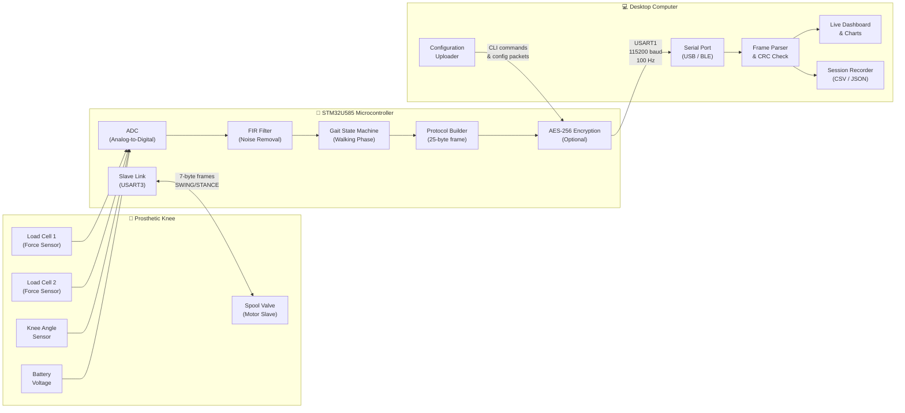

---

## 3. Hardware Used

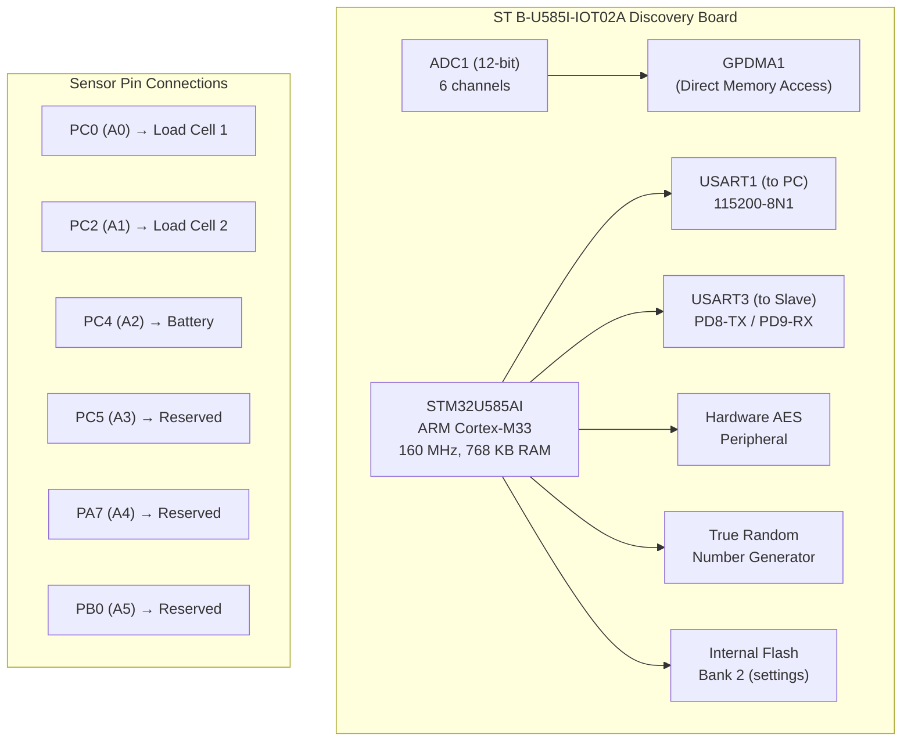

> [!IMPORTANT]
> The board uses **3 active sensor channels** (Force, Knee Angle, Battery). The other 3 Arduino-header channels (A3–A5) are configured but reserved for future use.

---

## 4. Firmware Data Pipeline — Step by Step

This is what happens inside the microcontroller every 10 milliseconds:

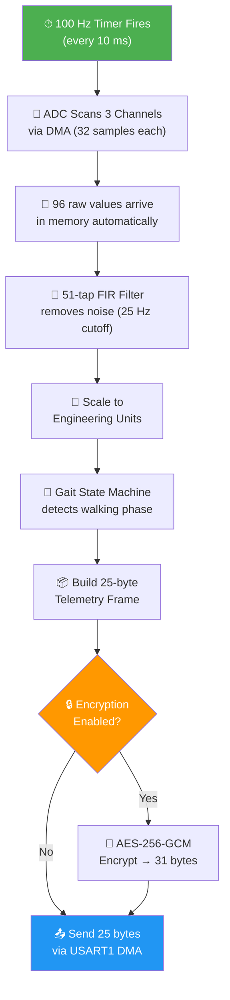

### Scaling Factors (ADC → Real-World Values)

| Sensor | Raw ADC | Scale Factor | Output Unit |
|--------|---------|-------------|-------------|
| Load Cell 1 (Force) | 0–4095 (12-bit) | × 300 | Newtons (N) |
| Load Cell 2 (Moment) | 0–4095 | × 60 | Newton-metres (Nm) |
| Knee Angle | 0–4095 | × 27 | Degrees (°) |
| Battery | 0–4095 | × 1.41 | Volts (V) |

---

## 5. Telemetry Frame Format

Every 10 ms, the firmware sends this exact 25-byte packet to the PC:

```
Byte:  [0] [1] [2] [3-4]   [5-6]    [7-8]   [9-10]  [11-12] [13]  [14-15] [16-22] [23-24]
       ─── ─── ─── ─────── ──────── ─────── ─────── ─────── ───── ─────── ─────── ───────
       AA  55  seq  Force   Moment   Knee    Valve   Battery State Fault   Padding  CRC-16
       ▲   ▲   ▲    i16×100 i16×100  i16×100 u16     u16×100 u8    u16     zeros   MODBUS
       │   │   │
       └───┴───┘
       Sync bytes (always 0xAA 0x55)
```

> [!TIP]
> All multi-byte values use **little-endian** byte order and **×100 fixed-point** encoding. For example, a force of 123.45 N is sent as the integer 12345.

---

## 6. Gait State Machine — Walking Phase Detection

The state machine identifies which phase of the walking cycle the patient is in. This is the core clinical intelligence of the system.

### 6.1 The 6 Gait Phases

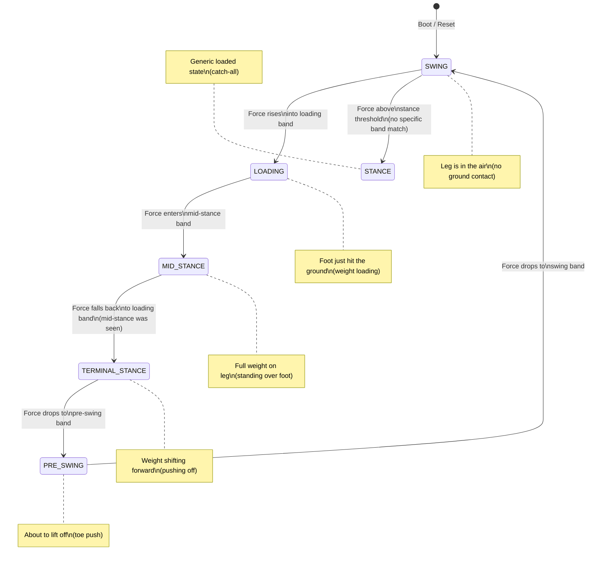

### 6.2 How It Decides (Decision Logic)

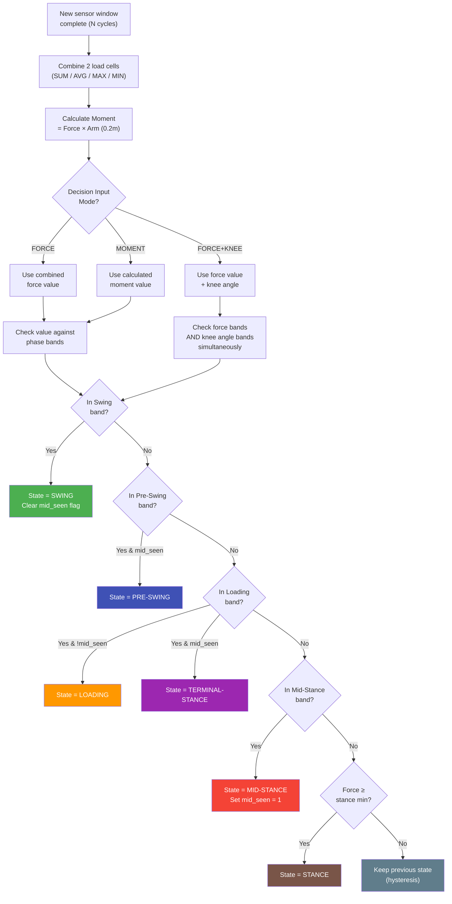

> [!NOTE]
> **The `mid_seen` flag** is the key sequencing trick: LOADING and TERMINAL-STANCE share the same force band, but LOADING can only happen *before* mid-stance is seen, and TERMINAL-STANCE can only happen *after*. The flag resets on every SWING.

### 6.3 Walking Cycle Diagram (Simplified)

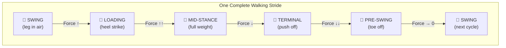

---

## 7. Slave Motor Link

The microcontroller also controls a **spool valve motor** on the prosthetic knee via a second UART:

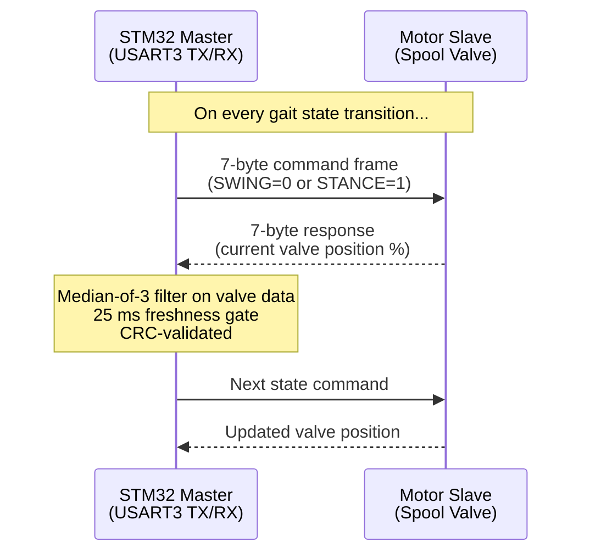

> The slave converts SWING/STANCE commands into hydraulic valve positions that control the knee's resistance during walking.

---

## 8. Fault Detection System

The firmware continuously monitors for problems and reports them as a 16-bit fault register in every frame:

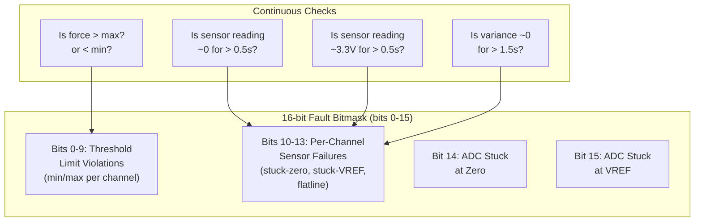

---

## 9. AES-256-GCM Encryption (Optional)

When encryption is enabled, every telemetry frame gets encrypted before transmission:

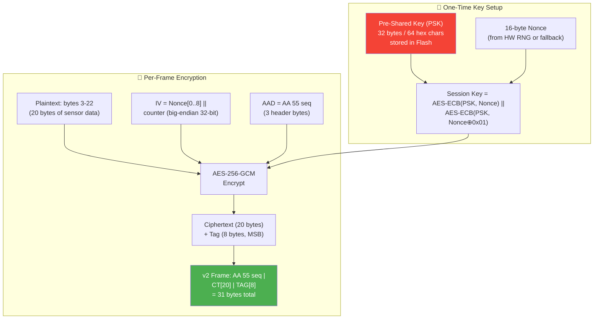

| Plain Frame (v1) | Encrypted Frame (v2) |
|---|---|
| 25 bytes | 31 bytes |
| AA 55 seq \| data \| CRC | AA 55 seq \| ciphertext[20] \| tag[8] |

---

## 10. Desktop App (Prosthetic Telemetry Studio)

### 10.1 App Architecture

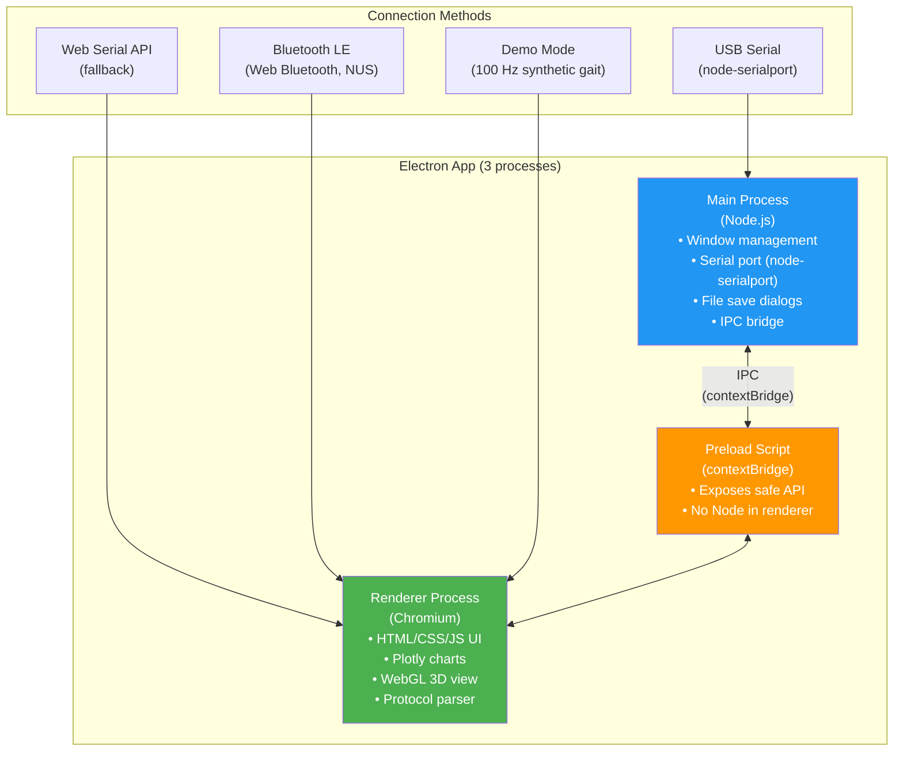

### 10.2 App Features — Tab Overview

The app has **16 tabs**. Here's what each one does:

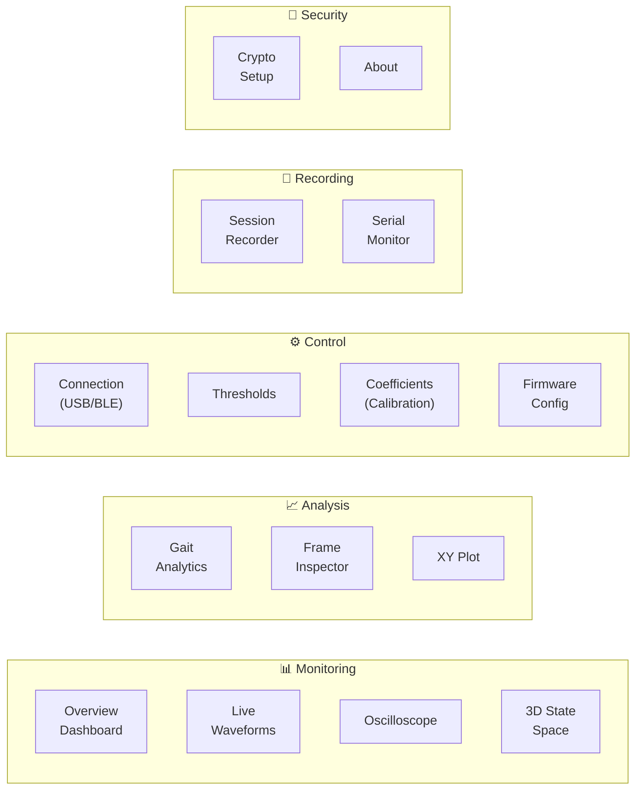

| Tab | What You See | Why It's Useful |
|-----|-------------|-----------------|
| **Overview** | 11 live KPI cards (force, angle, battery, faults, packet rate) | Quick health check at a glance |
| **Waveforms** | 4 scrolling charts (Force, Moment, Knee Angle, Battery) | See trends over time (5–60 s window) |
| **Oscilloscope** | Canvas-rendered glow traces, per-channel | Clean signal view like a lab scope |
| **3D State Space** | WebGL 3D plot (knee × force × moment) coloured by gait phase | Visualize the gait cycle as a 3D trajectory |
| **Gait Analytics** | Cadence, stride time, stance/swing %, peak values, symmetry | Quantitative gait assessment for clinicians |
| **Frame Inspector** | Hex dump of every 25-byte frame with field highlighting | Debug and verify protocol correctness |
| **Connection** | USB port selector, BLE scan, Demo mode toggle | Connect/disconnect from the device |
| **Thresholds** | Min/max sliders for each sensor channel | Set safety limits (triggers fault flags) |
| **Coefficients** | Scale, offset, VREF fields per sensor | Calibrate sensors without reflashing |
| **Firmware Config** | Gait state machine parameters (window, bands, mode) | Tune walking detection live via CLI |
| **Recording** | Start/stop, subject metadata, CSV/JSON export | Capture sessions for later analysis |
| **Serial Monitor** | Raw terminal with quick-command buttons | Direct CLI access to firmware |
| **Crypto** | PSK entry, one-click auto-setup, session status | Enable/disable encrypted link |

---

## 11. End-to-End Data Flow

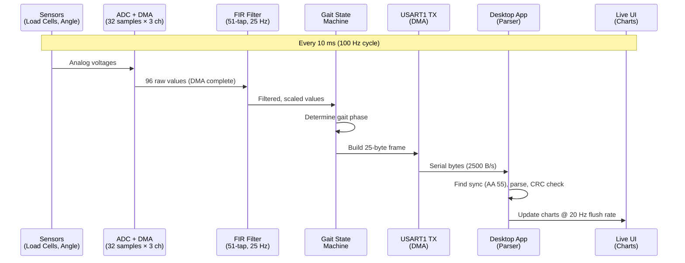

---

## 12. Firmware FreeRTOS Task Structure

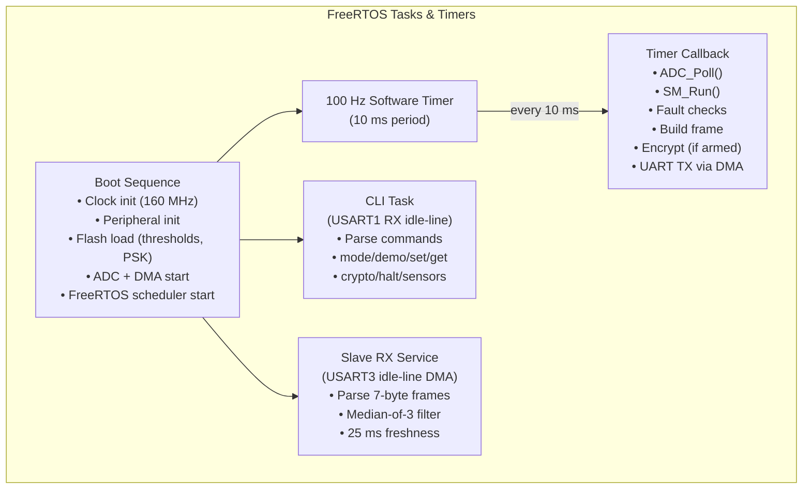

---

## 13. Configuration & Calibration Flow

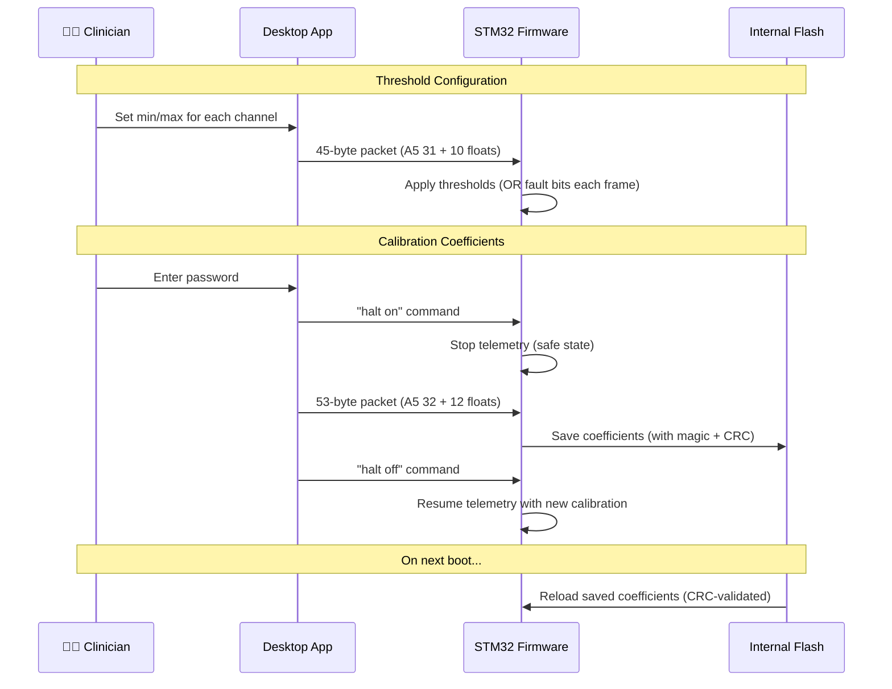

---

## 14. Development Timeline

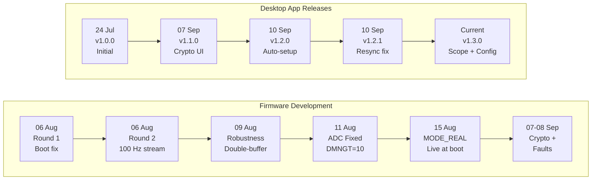

---

## 15. Progress Status

| Component | Feature | Status | Verification |
|-----------|---------|--------|-------------|
| Firmware | ADC / DMA / FIR acquisition | ✅ Complete | ✅ HW-verified |
| Firmware | 100 Hz telemetry frame | ✅ Complete | ✅ HW-verified |
| Firmware | 6-phase gait state machine | ✅ Complete | ⏳ Bench pending |
| Firmware | Faults / thresholds / coefficients | ✅ Complete | ⚠️ Simulated + partial |
| Firmware | AES-256-GCM encryption | ✅ Complete | ⚠️ Host vectors pass; bench pending |
| Firmware | Boot hardening | ✅ Complete | ✅ HW-verified |
| App | Transports (USB / BLE / Demo) | ✅ Complete | ✅ Functional |
| App | GUI (16 tabs) + charts | ✅ Complete | ✅ Captured / reviewed |
| App | Recording & export | ✅ Complete | ✅ Functional |
| App | Crypto session UI | ✅ Complete | ✅ Resync fix shipped |

---

## 16. Key Findings & Risks

> [!WARNING]
> **Documentation Drift:** Some documentation doesn't match the actual code:
> - Docs say USART2/PD5/PD6 for slave link → Code uses **USART3/PD8/PD9**
> - Docs claim 16 MHz ADC clock → Code correctly uses **4 MHz**
> - App docs show fault as uint8 → Code correctly uses **uint16** at offset 14
> - App battery defaults (10.5–13 V) don't match firmware's **4.2 V scale**

> [!CAUTION]
> - No CI pipeline or automated unit tests — verification is manual
> - End-to-end crypto bench test still pending

---

## 17. Recommended Next Steps

1. **Reconcile documentation** with the actual code constants
2. **Fix battery threshold defaults** in the app to match firmware's voltage scale
3. **Add automated test harness** for protocol parsing, CRC, state machine, and faults
4. **Add firmware CI** — compile + static analysis on every change
5. **Consolidate protocol constants** — single source of truth (`constants.js` in app)
6. **Complete crypto bench test** — end-to-end encrypted session on real hardware

---

## 18. Key Source Files Reference

### Firmware (`Core/Src/`)

| File | Purpose |
|------|---------|
| `main.c` | Boot, clock init, CLI command parser, UART callbacks |
| `adc.c` | ADC1 HAL init, 6-channel scan configuration |
| `adc_manager.c` | Register-level DMA setup, FIR filter, voltage scaling |
| `state_machine.c` | 6-phase gait detection with configurable bands |
| `smart_protocol.c` | 25-byte frame builder with CRC-16/MODBUS |
| `slave_comm.c` | USART3 slave link — 7-byte frames, median filter |
| `crypto.c` | AES-256-GCM with HW acceleration + SW fallback |
| `thresholds.c` | Threshold packet handler + flash persistence |
| `coefficients.c` | Calibration packet handler + flash persistence |
| `app_freertos.c` | RTOS objects, 100 Hz timer, telemetry callback |
| `sensor.c` | Per-channel stuck/flatline diagnostics |
| `fir_filter.c` | 51-tap Hamming low-pass filter implementation |

### Desktop App (`src/`)

| File | Purpose |
|------|---------|
| `main.js` | Electron main process — window, serial IPC, permissions |
| `preload.js` | Secure contextBridge API (no Node in renderer) |
| `renderer.js` | UI logic — tab management, chart updates, parser |
| `index.html` | Full HTML UI — all 16 tabs, Plotly integration |
| `scripts/constants.js` | Protocol constants shared across the app |

---

## 19. Glossary

| Term | Meaning |
|------|---------|
| **ADC** | Analog-to-Digital Converter — turns sensor voltages into numbers |
| **DMA** | Direct Memory Access — transfers data without using the CPU |
| **FIR** | Finite Impulse Response — a type of digital noise filter |
| **FreeRTOS** | Real-Time Operating System — manages tasks and timing |
| **CRC-16/MODBUS** | Error-checking code to detect data corruption |
| **AES-256-GCM** | Military-grade encryption algorithm |
| **PSK** | Pre-Shared Key — a secret password both sides know |
| **BLE / NUS** | Bluetooth Low Energy / Nordic UART Service |
| **Gait Cycle** | One complete step (heel strike → toe off → swing → next heel strike) |
| **Hysteresis** | Keeping the previous state when the signal is between two bands (prevents flickering) |
